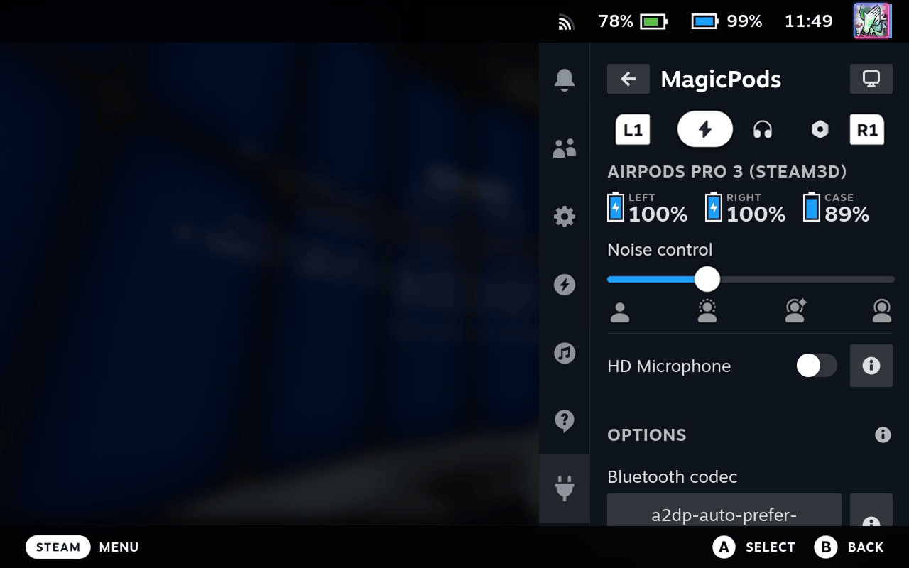
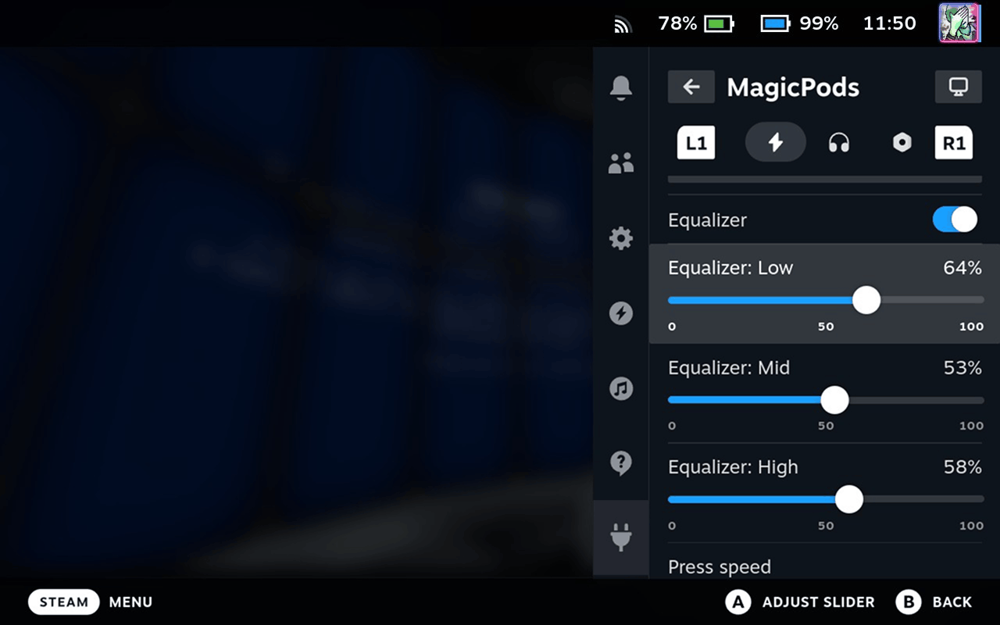
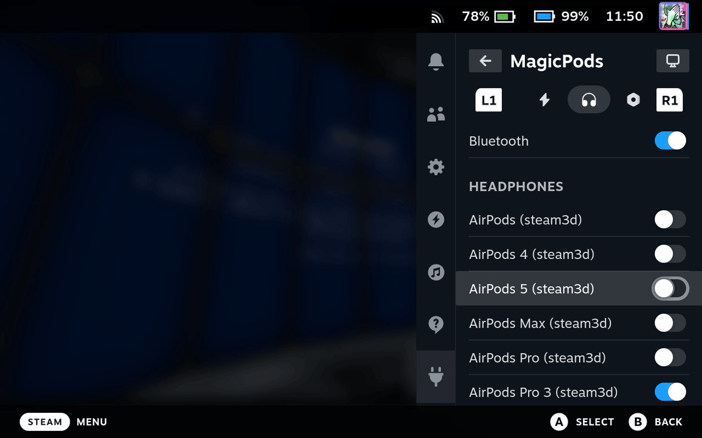
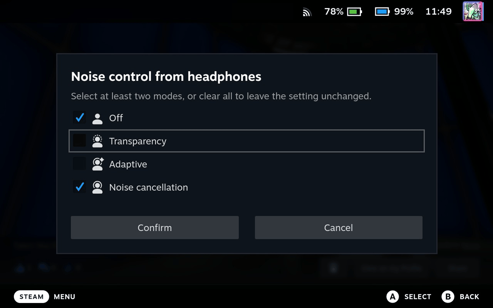
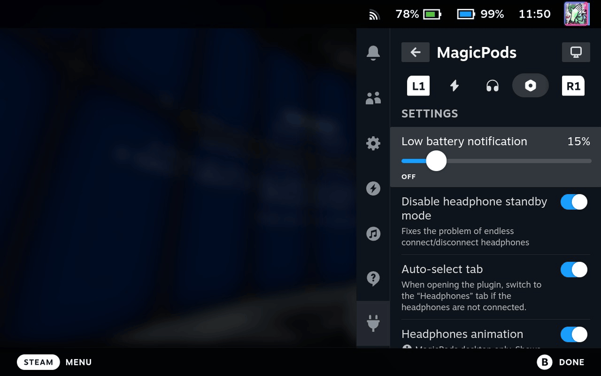
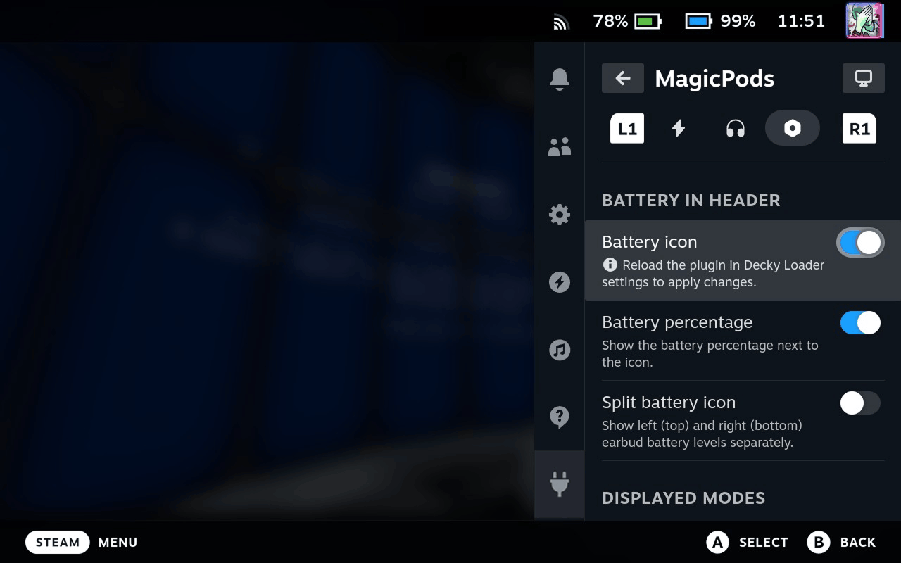
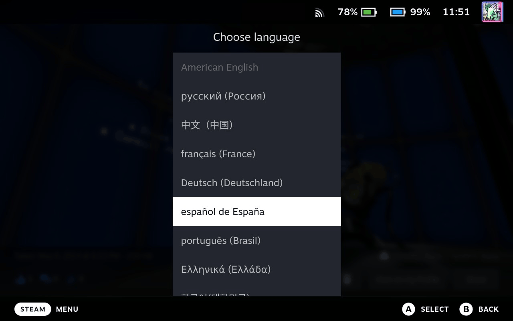

# MagicPods✨ for Steam Deck & Steam Machine

A magic plugin for Decky Loader that lets you easily control your AirPods, Beats, Galaxy Buds, and Pixel Buds right from Steam Gaming Mode.

Screenshots

  
  
  
  
  
  

## 🎨 Features

- Battery Monitoring - View headphone battery levels directly in Steam Gaming Mode.
- Noise Control - Switch between noise cancellation, transparency, adaptive, and other available modes.
- Bluetooth Management - Connect and disconnect headphones, control Bluetooth, and switch audio codecs.
- Connection Fixes - Fix headphone disconnection issues.
- [MagicPods for Linux](https://github.com/steam3d/MagicPodsLinux) Integration - Companion app for Desktop Mode.

## 🪄 Unlock AirPods & Beats Magic

Customize your AirPods and Beats without ever needing an iPhone.

### HD Microphone

- Get significantly better microphone quality on compatible AirPods with the H2 chip compared to standard Bluetooth Hands-Free mode.

### Smart Audio

- Conversation Awareness - Automatically lower audio volume when you start speaking.
- Personalized Volume - Enable or disable personalized volume adjustments.
- Ear Detection - Automatically pause playback, lower volume when you remove your earbuds.
- Audio Output Switching - Automatically switch between headphones and Steam Deck speakers when supported.

### Noise Control

- Adaptive Audio - Adjust how much outside noise you hear.
- Noise Cancellation with One AirPod - Enable noise cancellation while wearing a single AirPod.
- Earbud Noise Control Modes - Choose which modes are available when switching directly from your headphones.
- Off Listening Mode - Enable or disable the Off listening mode on compatible AirPods.

### Controls & Gestures

- Customize press-and-hold actions for each earbud.
- Adjust press speed and press-and-hold duration.
- Configure single and double presses for call controls.
- Customize volume swipe gestures.
- Change Digital Crown rotation direction on supported AirPods Max models.

### More Settings

- Custom Equalizer - Adjust bass, mids, and treble.
- Headphone Tones - Adjust the volume of built-in headphone tones.
- Optimized Charge Limit - Manage charging optimization on compatible models.
- Pause When Asleep - Configure automatic playback pausing on supported headphones.

*Available features depend on your headphone model and firmware. MagicPods automatically displays only the settings supported by your connected device.*

## 🎧 Supported Headphones

| Apple            | Beats                  | Samsung           | Google              |
| ---------------- | ---------------------- | ----------------- | ------------------- |
| AirPods 1        | PowerBeats Pro         | Galaxy Buds       | Pixel Buds A-Series |
| AirPods 2        | PowerBeats Pro 2       | Galaxy Buds Plus  | Pixel Buds Pro      |
| AirPods 3        | PowerBeats 3           | Galaxy Buds Live  | Pixel Buds Pro 2    |
| AirPods 4        | PowerBeats 4           | Galaxy Buds Pro   | Pixel Buds 2a       |
| AirPods 4 (ANC)  | Beats Fit Pro          | Galaxy Buds 2     |                     |
| AirPods 5        | Beats Studio Buds      | Galaxy Buds 2 Pro |                     |
| AirPods 5 (WCC)  | Beats Studio Buds Plus | Galaxy Buds FE    |                     |
| AirPods Pro      | Beats Studio Pro       | Galaxy Buds 3     |                     |
| AirPods Pro 2    | Beats Solo 3           | Galaxy Buds 3 Pro |                     |
| AirPods Pro 3    | Beats Solo Pro         | Galaxy Buds Core  |                     |
| AirPods Max      | Beats Studio 3         | Galaxy Buds 3 FE  |                     |
| AirPods Max 2024 | Beats X                | Galaxy Buds 4     |                     |
| AirPods Max 2    | Beats Flex             | Galaxy Buds 4 Pro |                     |
|                  | Beats Solo Buds        |                   |                     |
|                  | Beats Solo 4           |                   |                     |
|                  | Beats 360              |                   |                     |
|                  | Powerbeats Fit         |                   |                     |

## 💾 Installation

### Using the Decky Store

1. Install [Decky Loader](https://github.com/SteamDeckHomebrew/decky-loader/tree/main?tab=readme-ov-file#-installation).
2. Switch to Steam Gaming Mode.
3. Press  to open the Quick Access Menu.
4. Open the  Decky Loader tab.
5. Select  in the upper-right corner.
6. Find `MagicPods` in the plugin list or use the search.
7. Select `Install`.

### Using Decky Developer Mode

1. Install [Decky Loader](https://github.com/SteamDeckHomebrew/decky-loader/tree/main?tab=readme-ov-file#-installation).
2. Switch to Steam Gaming Mode.
3. Press  to open the Quick Access Menu.
4. Open the  Decky Loader tab.
5. Select  in the upper-right corner.
6. Enable Developer Mode in the General tab.
7. Open the Developer tab.
8. Enter `https://magicpods.app/plugin`.
9. Select `Install`.

## 🚀 Getting Started

After installing MagicPods, open the Quick Access Menu using , go to the  Decky Loader tab, and select  MagicPods.

MagicPods has three main tabs:

-  Battery - View battery levels and additional headphone features.
-  Headphones - Connect or disconnect supported headphones and manage Bluetooth.
-  Settings - Explore additional features, preferences, and useful information.

Pair your headphones through SteamOS Bluetooth settings first. Then select and connect them in MagicPods to see their battery levels and available features in the Battery tab.

## Known Issues

Bluetooth changes made through MagicPods are not reflected in the Steam interface. The current Bluetooth status is displayed in MagicPods.

## 💖 Community

- [Help translate MagicPods](https://weblate.magicpods.app/engage/magicpods-steamdeck/).
- [Join Discord to suggest features or report bugs](https://discord.com/invite/UyY4PY768V).
- 💰 [Support the project](https://magicpods.app/donate/).

---
Developed by [Aleksandr Maslov](https://github.com/steam3d/) and [Andrey Litvintsev](https://github.com/andreylitvintsev).